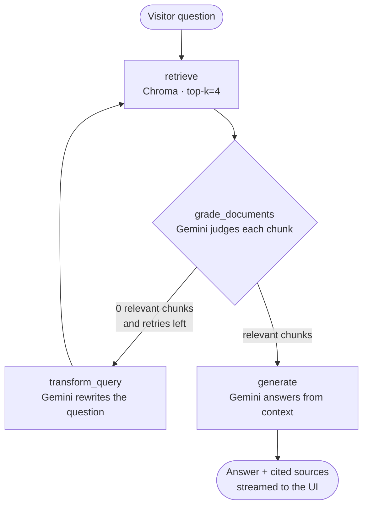

# ReflectRAG-FullStack 🏥✨

**A full-stack showcase of ReflectRAG — a self-correcting (Corrective RAG) hospital assistant built with LangGraph, Gemini, Chroma, FastAPI and React.**

A fictional **Green Field Hospital** website whose AI assistant, **GreenCare**, answers visitor questions strictly from the hospital's own documents — grading every retrieved chunk, rewriting weak queries, retrying when retrieval fails, and streaming the entire pipeline live into the browser.

> **Live demo:** 🌐 Site: `https://<your-frontend-url>.onrender.com` · ⚙️ API: `https://<your-backend-url>.onrender.com/api/health`
> *(The free backend sleeps after ~15 min idle — the first question may take ~50 s to wake it.)*

[](https://www.python.org)
[](https://fastapi.tiangolo.com)
[](https://langchain-ai.github.io/langgraph/)
[](https://ai.google.dev)
[](https://www.trychroma.com)
[](https://react.dev)
[](https://vite.dev)
[](#-license)

---

## ✨ Highlights

- **Corrective RAG, not plain RAG** — a LangGraph state machine (`retrieve → grade → rewrite → generate`) that grades each retrieved chunk for relevance, **rewrites the query and retries** when retrieval comes back empty, and only then generates the answer.
- **Grounded, cited answers** — GreenCare answers *only* from the hospital knowledge base (`Hospital_DOC/`), and the UI shows **which documents** every answer came from.
- **Live pipeline visualization** — the FastAPI bridge streams the LangGraph execution as NDJSON events, so visitors watch each node execute in real time with per-step timings.
- **Battle-tested graph** — max-retry loop (`MAX_RETRIES = 2`), deterministic temperature 0, and persisted **ChromaDB** vector store (built once from the hospital docs with Gemini embeddings).
- **One-key, zero-cost demo** — runs entirely on the free Gemini API tier and deploys free on Render.

## 🧠 The pipeline



Every step emits a `{"type":"step", "node":..., "seconds":...}` event over NDJSON — the React UI turns them into the live "Retrieving → Checking relevance → Refining → Composing" progress you see in the chat dock.

## 🏗️ Architecture

```
React 19 + Vite (Green Field Hospital site)
        │  fetch /api/ask (NDJSON stream)
        ▼
FastAPI bridge (api_server/main.py)
        │  imports the pre-compiled graph — read-only
        ▼
LangGraph state machine (gemini_crag.py)
        ├── ChromaDB (persisted vector_database/)
        └── Google Gemini  ← LLM (gemini-flash-lite) + embeddings (via API key)
```

## 🧰 Tech stack

| Layer | Tools |
|---|---|
| RAG pipeline | LangGraph 1.2, LangChain 1.4, Gemini Flash Lite, Gemini Embeddings |
| Vector store | ChromaDB 1.5 (persisted on disk, committed to the repo — ~2.4 MB) |
| API | FastAPI + Uvicorn, NDJSON streaming, CORS |
| Frontend | React 19, Vite 8, Framer Motion, Lucide, react-markdown |
| Docs pipeline | `PyPDFLoader` / `TextLoader` + `RecursiveCharacterTextSplitter` |

## 📁 Project structure

```
ReflectRAG-FullStack/
├── gemini_crag.py          # The C-RAG LangGraph pipeline (retrieve→grade→rewrite→generate)
├── api_server/
│   └── main.py             # FastAPI bridge: /api/health + /api/ask (NDJSON stream)
├── frontend/               # Green Field Hospital website (React 19 + Vite)
│   └── src/                # Sections, GreenCare chat dock, api.js stream reader
├── Hospital_DOC/           # Knowledge base: hospital FAQ (.txt) + info guide (.pdf)
├── Hospital_RAG/
│   ├── Hospital.ipynb      # Notebook that built the vector database
│   └── vector_database/    # Persisted ChromaDB store (committed, ~2.4 MB)
|
├── requirements.txt        # Backend dependencies (Python 3.11, pinned)
└── .env.example            # Template for the required Google API key
```

## 🚀 Run it locally

**Backend** (from the repo root, Python 3.11):

```bash
python -m venv venv && source venv/bin/activate
pip install -r requirements.txt
cp .env.example .env        # then paste your Gemini API key into .env
uvicorn api_server.main:app --port 8000
```

**Frontend** (new terminal):

```bash
cd frontend
npm install
npm run dev                 # http://localhost:5173 — /api is proxied to :8000 automatically
```

Ask GreenCare things like *"What are the visiting hours?"* or *"Do you have a cardiology department?"*.

## ☁️ Deployment (free)

Deploys on [Render](https://render.com)'s free tier in two services:

1. **Web Service** (Python 3.11) — build: `pip install -r requirements.txt`, start:
   `uvicorn api_server.main:app --host 0.0.0.0 --port $PORT`, env: `Google_API_Key`
2. **Static Site** (root dir `frontend`) — build: `npm install && npm run build`, publish dir `dist`,
   env: `VITE_API_BASE=https://<backend-url>.onrender.com`

## ⚠️ Disclaimer

Green Field Hospital is a **fictional showcase** — the site, its doctors and all medical content are invented for demo purposes. It is **not** a real hospital and provides no medical services or advice.

## 📄 License

MIT — use it, fork it, learn from it.
